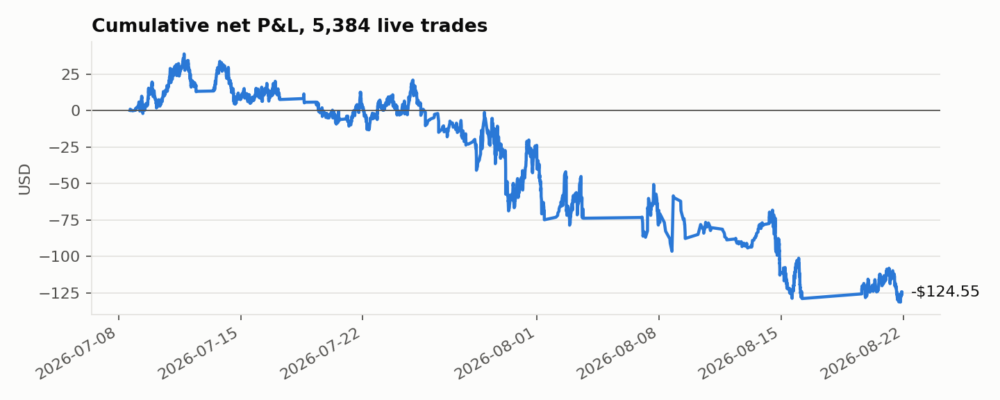
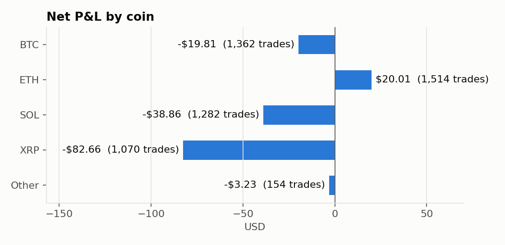
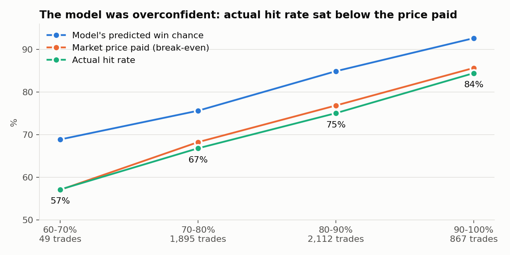
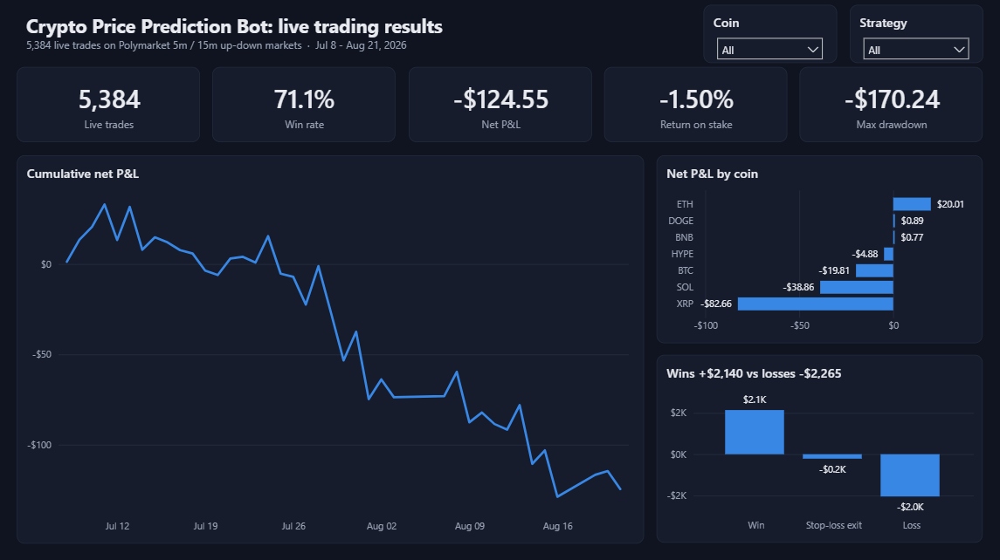

# Crypto Price Prediction Bot

A machine-learning bot that traded Polymarket's 5-minute and 15-minute "will BTC/ETH/SOL/XRP be up or down" markets with real money. It ran 24/7 on AWS EC2 from July to August 2026 and placed **5,384 live trades**.

**Stack:** Python · scikit-learn · pandas · Parquet · SQLite · pmdata API · Power BI · AWS EC2



## What it does

1. **Data collection.** Downloaded about 45,000 per-second order-book files from the [pmdata](https://pmdata.dev) API, along with Binance 1-second spot prices, Chainlink settlement prices and Polymarket market outcomes. Raw data is stored as Parquet, and download progress is tracked in SQLite. See `polymarket/backtest/fetch/`.
2. **Modelling.** Built an 11-feature dataset of about 2.85M labelled rows and trained gradient-boosting classifiers (scikit-learn `HistGradientBoostingClassifier`) with walk-forward validation: train on the past, test on the next period. Backtests replay each bet against the real order book instead of the quoted price. See `polymarket/backtest/training/` and `polymarket/backtest/engine/`.
3. **Live trading.** A scheduler scores every open market once per second. When the model's probability beats the market price by enough after fees, the bot sizes the bet as a fraction of equity and sends it to Polymarket's order book. A drawdown limit halts trading. See `polymarket/src/cryptobot/`.
4. **Reconciliation.** Background jobs settle resolved markets every 5 minutes, check the trade ledger against the on-chain wallet balance every 10 minutes and repair orphaned orders. A daily job checkpoints the SQLite database and checks free disk space. See `polymarket/src/cryptobot/reconciliation/` and `polymarket/infra/cron.daily.sh`.
5. **Analysis.** Live trades were exported from SQLite into a three-page Power BI dashboard covering win rate, P&L by coin, model accuracy and timing. See [`analysis/powerbi/`](analysis/powerbi/).

## Results

| | |
|---|---|
| Live trades | 5,384 (5,382 resolved) |
| Period | 2026-07-08 to 2026-08-21 (40 trading days) |
| Win rate | 71.1% |
| Net P&L | −$124.55 on $8,321 staked (−1.5% ROI) |
| Average win / average loss | $0.56 / −$1.46 |
| Max drawdown | −$170.24 |



**Why a 71% win rate still lost money.** On these markets, the price you pay is the break-even win rate. A share bought at 75¢ needs to win more than 75% of the time to profit. The model called the direction correctly 73.3% of the time, but paid 74.9% on average. It was also overconfident: when it said 85%, it hit about 75%.



The main lesson was that being right more often than not isn't enough. A prediction model has to beat the market's own probability by more than fees and slippage. The strategy was retired on 2026-08-19 after these live results.

## Power BI dashboard



More pages, plus how to open the report: [`analysis/powerbi/`](analysis/powerbi/).

## Repository layout

```
polymarket/
  backtest/
    fetch/       pmdata, Binance, Chainlink and Polymarket data downloaders
    training/    feature building, walk-forward training, model export
    engine/      order-book replay used by the backtests
    studies/     research experiments
  src/cryptobot/
    scheduler/       1-second tick loop
    strategy/        model loading and scoring
    execution/       gates, sizing, order placement, ledger
    reconciliation/  settlement and wallet reconciliation
  src/cryptobot_polymarket/  Polymarket API client: markets, order books, orders, wallet
  live/          live strategy config and systemd units
  dashboard/     operator web dashboard
  infra/         EC2 deploy scripts and environment template
analysis/        trade dataset, charts, Power BI guide and DAX measures
```

## Running it

```bash
pip install -e ".[dev]"
cp .env.example .env    # add your own API keys; DRY_RUN=true by default
pytest
```

About 1,750 tests pass. A few boot tests need the trained model files, so they are skipped on a fresh clone.

Trained model files, raw market data and the live database are not in the repo: they're large and were gitignored. Running the bot live needs your own Polymarket wallet and API keys, plus retrained models made with the scripts in `polymarket/backtest/training/`.

Analysis only:

```bash
pip install pandas matplotlib
python analysis/make_charts.py
```

---

This is a personal project and not financial advice.
