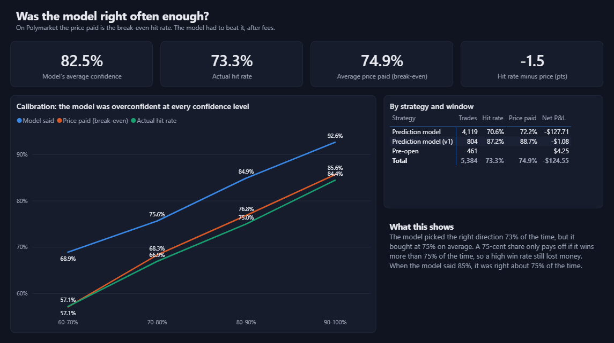
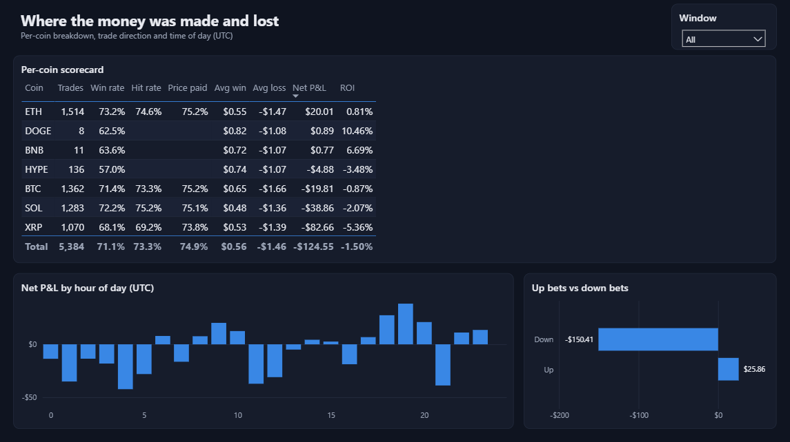

# Power BI dashboard

A three-page Power BI report built on `../data/trades.csv` (5,384 live trades). It's saved as a Power BI Project (`.pbip`), so the report and data model are plain text files.

## Open it

1. Run `python analysis/powerbi/build_pbip.py`. This points the report at your copy of `trades.csv`.
2. Open `analysis/powerbi/CryptobotTrades.pbip` in Power BI Desktop.
3. Click **Refresh** to load the data.

## Pages

| Page | What it shows |
|---|---|
| Overview | KPI cards (trades, win rate, net P&L, ROI, max drawdown), cumulative P&L, P&L by coin, wins vs losses. Coin and strategy slicers. |
| Model accuracy | Calibration chart: the model's predicted probability vs the price paid vs the actual hit rate, per confidence band. Results by strategy and window. |
| Coins & timing | Per-coin scorecard, P&L by hour of day (UTC), up bets vs down bets. Window slicer. |

## How it's built

- `build_pbip.py` generates the whole project: the semantic model (TMDL: typed columns, 14 DAX measures, a `Prob Bucket` calculated column), the report pages and visuals (PBIR JSON), and a dark custom theme. Change the layout there and rerun it instead of editing the JSON by hand.
- `measures.dax` lists the same measures for copying into another report.

## Reference numbers

| Measure | Value |
|---|---|
| Resolved trades | 5,382 (2 still pending) |
| Net P&L | −$124.55 on $8,321 staked |
| Win rate | 71.1% |
| ROI | −1.50% |
| Avg win / avg loss | $0.56 / −$1.46 |
| Max drawdown | −$170.24 |
| Model hit rate vs price paid (prediction-model trades) | 73.3% vs 74.9% |
